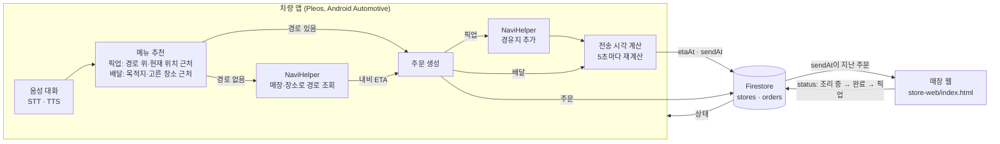

# DriveOrder — 도착하는 순간 완성되는 주문

> 현대자동차그룹 차량용 앱 개발 공모전 출품작 · Pleos Connect 차량 앱

운전 중에 **음성만으로** 포장 주문을 하면, 앱이 **내 경로 위 매장**을 경유지로 넣고
**매장 도착 시각에 맞춰 조리가 끝나도록** 주문 전송 시각을 계산해 매장에 전달합니다.

```
주문 전송 시각 = 매장 도착 예정 시각 − 조리 시간 − 여유 30초
```

정체로 도착이 늦어지면 전송 시각도 자동으로 뒤로 미뤄지고, 이미 전송된 뒤라면 매장 화면에 지연 시간이 표시됩니다.

---

## 왜 필요한가

| 문제 | DriveOrder의 해결 |
|---|---|
| 운전 중 휴대폰 주문은 위험하고 불법(도로교통법 제49조) | 화면을 보지 않고 **음성 + 네/아니요**로 주문 |
| 출발 전이나 도착 후에 주문하면 매장에서 또 기다림 | 내비 ETA로 **도착 시각에 맞춰** 조리 시작 |
| 배달·포장 앱은 터치 조작 전제 | 차량 내비·음성 SDK에 맞춘 차량 전용 흐름 |

## 사용 시나리오

1. 운전자: 🎤 버튼 → 앱: "무엇을 드시고 싶으세요?"
2. 운전자: "국물 있는 거" → 앱: "들러서 받는 픽업과 배달 중 어떤 걸로 할까요?"
3. 운전자: "픽업" → 앱: "한끼찌개의 된장찌개, 8500원이에요. 약 20분 뒤 도착하면 바로 받을 수 있어요. 주문할까요?"
4. 운전자: "네" → 주문 저장, 매장이 **내비 경유지로 자동 추가**
5. 주행 중 5초마다 내비의 **매장(경유지)까지 남은 시간**으로 전송 시각 재계산
6. 전송 시각이 되면 매장 웹 "접수 대기"에 주문이 뜨고, 매장은 조리 시작 → 완료 → 픽업 완료 처리
7. 차량 앱에 상태(조리 중·조리 완료)가 표시되고, 매장 도착 시 음식이 준비되어 있음

"배달로 치킨", "치킨 집으로 보내 줘"처럼 음식과 방식(장소)을 한 번에 말하면 그 질문은 건너뜁니다.

### 음성 대화 흐름

```
① 무엇을 드시고 싶으세요?          "국물", "치킨", "아무거나"
② 픽업과 배달 중 어떤 걸로 할까요?  "픽업" / "배달"
③ (배달 + 내비 목적지 없음)
   어디로 배달할까요?              "집", "강남역"   ← 내비 즐겨찾기·최근 목적지에서 찾음
④ ○○의 △△, 9000원이에요… 주문할까요?  "네" / "아니요"(다음 후보) / "국물로"(다시 찾기)
⑤ 주문
```

| | 내비에 경로가 **있을 때** | 경로가 **없을 때** |
|---|---|---|
| 🛍️ 픽업 | 가는 **경로**에서 1km 이내 매장 → 매장을 **경유지로 추가**하고 주문 | **현재 위치** 5km 이내 매장(도착 후 대기가 짧은 순) → **매장으로 경로 조회** → 내비 ETA가 오면 주문 |
| 🛵 배달 | 내비 **목적지** 3km 이내 매장 → 경로는 그대로 두고 주문 | 고른 **장소** 3km 이내 매장 → **그 장소로 경로 조회** → 내비 ETA가 오면 주문 |

경로가 없을 때 후보를 고르는 단계에서는 직선거리 × 1.3 ÷ 36km/h로 도착 시간을 어림하고, 실제 주문은 경로 조회 뒤 **내비 ETA**로 합니다.

### 픽업과 배달의 전송 시각

| | 🛍️ 픽업 | 🛵 배달 |
|---|---|---|
| 기준 시각 (`etaAt`) | 매장 도착 시각 | 목적지 도착 시각 |
| 전송 시각 (`sendAt`) | 매장 도착 − 조리 − 30초 | 목적지 도착 − (조리 + 배달 이동) − 30초 |
| 배달 이동 시간 | – | 3분(포장·배차) + 매장~목적지 직선거리 ÷ 333m/분, 올림 |

## Pleos Connect SDK 활용

부가 기능이 아니라 **핵심 동작마다** 차량 SDK를 씁니다.

| SDK | 쓰는 기능 | DriveOrder에서의 역할 |
|---|---|---|
| **NaviHelper** 3.0.5 | `getDestinationInfo`, `getCurrentLocationInfo` | 목적지 ETA·현재 위치 → 경로 위 매장 추천 |
| | `addWaypoint`, `getWaypointInfo`, `onWayPointArrived` | (픽업) 주문 매장을 경유지로 추가, **경유지까지 남은 시간으로 전송 시각 계산** |
| | `getDestinationInfo` 목적지 이름·좌표·ETA | (배달) 목적지 근처 매장 추천, **목적지 도착 시각으로 전송 시각 계산**, 배달 받을 곳 |
| | `requestRoute`, `onRouteStarted` | 경로가 없을 때 고른 매장(픽업)·장소(배달)로 **경로 조회 후 그 ETA로 주문** |
| | `getBookmarkInfo`, `getRecentDestinationInfo` | "어디로 배달할까요?"에 답할 장소 후보 (집·회사·최근 목적지) |
| **SpeechToText** 3.3.1 | `request`, `ResultListener.onUpdated` (ON_DEVICE) | 운전자의 메뉴 요청·네/아니요 인식 |
| **TextToSpeech** 3.3.1 | `speak`, `EventListener.onDone` (ON_DEVICE) | 추천·확인 안내, 안내가 끝나면 자동으로 듣기 시작 |

ON_DEVICE 모드라 서버 앱 등록(Client ID/Secret) 없이 동작합니다.

## 시스템 구조



- **전송은 시각(`sendAt`) 기반**입니다. 매장 웹은 `sendAt`이 지난 주문만 보여 주므로, 차량 앱이 잠시 꺼져 있어도 정해진 시각에 주문이 매장에 뜹니다.
- 차량 앱은 `etaAt`·`sendAt`만, 매장 웹은 `status`만 **부분 갱신**해 서로의 값을 덮어쓰지 않습니다.
- Pleos에는 Google Play 서비스가 없을 수 있어 Firebase SDK 대신 **Firestore REST API**를 씁니다.
- 실제 배달 앱은 외부 연동이 불가능해 **가상 매장 7곳**(`app/src/main/assets/stores_seed.json`, 이름 끝에 "(가상)". 강남역 주변 5곳 + 경로 없이 '근처 픽업'을 시연할 출발지 근처 2곳)과 매장 웹으로 대체했습니다.

### 주문 상태

```
scheduled(전송 대기) → sent(매장 접수 대기) → cooking(조리 중) → ready(조리 완료) → picked_up(픽업 완료)
```

배달 주문도 같은 상태를 씁니다. `ready`는 "조리 완료 · 배달 중", `picked_up`은 "배달 완료"로 표시합니다. 주문 문서의 `type`(`pickup`/`delivery`), `deliveryMin`, `deliveryTo`로 구분합니다.

## 실행 방법

### 준비물

- Android Studio (AGP 9.5, Kotlin 2.2, compileSdk 37 / minSdk 28)
- Pleos Connect Emulator v2.1.0 (Android Automotive, API 34, 화면 2560×1440 · 160dpi) — [설치 가이드](https://document.pleos.ai/docs/connect/guide/getting-started/application-development/setup-connect-sdk-emulator)
- Firebase 프로젝트의 Firestore (프로젝트 ID는 `FirestoreRest.kt`의 `PROJECT_ID`)

### 1. 에뮬레이터 실행

외장 GPU가 없는 노트북에서는 하드웨어 렌더링이 실패할 수 있어 소프트웨어 렌더링으로 실행합니다.

```bash
emulator -avd Pleos_Connect_v2.1.0 -no-snapshot-save -gpu swiftshader_indirect
```

### 2. 앱 설치

**APK 파일 위치: [`apk/TEAMNAME_DriveOrder_release.apk`](apk/TEAMNAME_DriveOrder_release.apk)** (서명된 release 빌드, 패키지 `com.driveorder.app`)

```bash
adb install -g apk/TEAMNAME_DriveOrder_release.apk
```

소스에서 직접 실행하려면 Android Studio에서 실행하거나:

```bash
./gradlew installDebug
```

release APK를 다시 만들려면 프로젝트 루트에 `keystore.properties`(storeFile, storePassword, keyAlias, keyPassword)를 두고 `./gradlew assembleRelease`를 실행합니다. 서명 키와 이 파일은 저장소에 올리지 않습니다.

### 3. 매장 웹 열기

`store-web/index.html`을 브라우저로 엽니다(서버 불필요). 또는:

```bash
python -m http.server 8765 --directory store-web
```

### 4. 데모 순서

1. **③ 매장 데이터 업로드 (최초 1회)** — Firestore에 가상 매장 7곳 저장 (보안 규칙 적용 *전*에 실행)

**경로가 없을 때** (에뮬레이터를 막 켠 상태)

2. **🎤 음성 주문** → "국물 있는 거" → "픽업" → "네" — 출발지 근처 판교든든국밥으로 경로가 잡히고, 내비 ETA로 주문 생성
3. (주문을 닫고 내비 안내 종료 후) **🎤 음성 주문** → "국물 있는 거" → "배달" → "강남역" → "네" — 강남역으로 경로가 잡히고 배달 주문 생성

**경로가 있을 때**

4. **① 목적지: 강남역 (데모)** — 에뮬레이터 기본 위치(성남 42dot 사옥)에서 강남역까지 약 21분 경로
5. **데모 주행: 켜짐** — 아래 "에뮬레이터 한계" 참고
6. **🎤 음성 주문** → "국물 있는 거" → "픽업" → "네" — 가는 길 매장을 경유지로 추가
7. 매장 웹에서 "예약됨" 카운트다운 → "접수 대기" 이동 확인 → 조리 시작/완료/픽업 완료
8. **정체 +3분**을 누르면 전송 시각이 3분 미뤄지는 것을 매장 웹에서 확인
9. 배달: **🎤 음성 주문** → "치킨" → "배달" → "네" — 목적지를 묻지 않고, 경유지도 추가하지 않음. 매장 웹 카드에 "🛵 배달 → 강남역"과 배달 출발까지 남은 시간이 표시됨

마이크가 없으면 🎤 옆의 대체 버튼("국물 있는 거", "픽업", "배달", "강남역", "네" …)으로 같은 말을 입력할 수 있습니다.

> 매장마다 영업시간이 있습니다(예: 찌개집 10~22시, 치킨집 15~24시). 늦은 시각에는 추천이 줄어드니
> "시간: 현재 시각" 버튼으로 데모 시각(12시·18시)을 바꿀 수 있습니다.

## 테스트

SDK와 무관한 핵심 로직은 순수 Kotlin으로 분리해 PC에서 단위 테스트합니다 (57개).

```bash
./gradlew testDebugUnitTest
```

| 테스트 | 검증 내용 |
|---|---|
| `OrderSchedulerTest`, `OrderFlowTest` | 전송 시각 계산, 정체 시 연기, 이미 전송된 주문은 도착 시각만 갱신 |
| `RecommenderTest` | 영업시간·경로 이탈 거리·도착 전 조리 가능 여부·취향 태그, 배달(목적지 반경·배달 시간 포함 조건), 경로 없을 때 근처 픽업(대기 짧은 순)·예상 주행 시간 |
| `VoiceDialogTest` | 음성 대화 흐름(음식 → 픽업/배달 → 배달 장소 → 제안 → 네/아니요), 경로 유무에 따른 분기, 장소 인식(집·이름), 무응답·못 알아들음 2회 종료, 취소 |
| `PickupWaypointTest` | 내비 경유지 목록에서 주문 매장 찾기 |
| `DemoDriveTest` | 데모 주행 중 전송 시각 고정, 정체 시 연기 |

에뮬레이터에서 확인한 것: 내비 경로·ETA 수신, 경유지 추가와 경유지 ETA 수신, TTS 재생과 STT 듣기 시작,
음성 흐름(대체 버튼 입력) → 주문 → 경유지 추가, 백그라운드에서 정해진 시각에 `sent` 전환,
경로가 없을 때 근처 매장 픽업·지정 장소 배달 → 경로 조회 → 내비 ETA로 주문 (2026-11-13).

## 프로젝트 구조

```
app/src/main/java/com/example/myapplication/
├── MainActivity.kt          화면, NaviHelper·STT·TTS 연결, 5초 조회 루프
├── Recommender.kt           메뉴 추천 (픽업: 경로 위, 배달: 목적지 근처, 규칙 기반)
├── OrderScheduler.kt        전송 시각 계산·재계산
├── Order.kt                 주문 데이터와 상태
├── VoiceDialog.kt           음성 대화 흐름과 문장 해석
├── PickupWaypoint.kt        경유지 ↔ 주문 매장 매칭
├── OrderTrackingService.kt  주문 진행 중 백그라운드 동작 유지 (포그라운드 서비스)
├── DemoDrive.kt             데모용 가상 주행
├── FirestoreRest.kt         Firestore REST 클라이언트
└── StoreJson.kt             JSON → 매장 객체
store-web/index.html         가상 매장 주문 접수 화면
seed/stores_seed.json        가상 매장·메뉴 데이터
firestore.rules              Firestore 보안 규칙
```

## 알려진 한계

- **에뮬레이터에서는 차가 움직이지 않습니다.** 에뮬레이터가 보내는 GPS(NMEA) 문장의 체크섬이 항상 `*47`로 고정되어 내비가 위치를 무시합니다. 그래서 남은 시간이 줄지 않고 전송 시각이 계속 밀립니다. 시연에는 **데모 주행**(경과 시간만큼 남은 시간을 줄이는 가상 주행)을 씁니다. 실제 차량에서는 끄고 사용합니다.
- **결제는 아직 없습니다.** PG 테스트 모드(토스페이먼츠) 연동은 2차 계획입니다.
- **인증이 없습니다.** 보안 규칙으로 문서 모양과 상태 순서는 제한하지만, 누가 쓰는지는 구분하지 못합니다. 실서비스에는 Firebase Auth가 필요합니다.
- 음성 문장 해석은 키워드 규칙 기반입니다(LLM SDK는 에뮬레이터 v2.1.0에서 제공 종료).
- 에뮬레이터에서 실제 목소리로 인식하려면 노트북 마이크를 연결해야 합니다(`adb emu avd hostmicon` 또는 Extended controls → Microphone). 연결 후 실제 음성 인식을 확인했습니다(2026-11-12).
- 듣는 중 8초 동안 말이 없으면 한 번 다시 묻고, 또 말이 없으면 주문을 취소합니다(마이크 미연결 시 무한 대기 방지).
- 배달은 실제 배달 대행 연동 없이 매장 웹에서 "배달 완료"를 누르는 것으로 대체합니다. 배달 시간은 직선거리로 추정합니다.

## 로드맵 (2차)

- PG 테스트 결제(빌링키, 마지막 음성 확인 후 결제)
- 배달: 배달 대행 연동, 실제 도로 거리 기반 배달 시간, 목적지 주소 상세(동·호수) 입력
- 매장 접근 알림(지오펜스), 주행/정차 화면 분리(Vehicle SDK)
- 탑승 인원에 맞춘 추천(Vehicle 착좌 정보)

> Vehicle SDK 퍼미션은 Pleos App Market과 사전 협의·승인된 경우에만 선언할 수 있고, 승인되지 않은 퍼미션을 선언하면 심사를 통과할 수 없습니다([App Review Guidelines](https://document.pleos.ai/docs/pleos-only/distribute/app-review-guide/review-functionality-performance-stability)). 그래서 지금 앱은 Vehicle SDK를 포함하지 않으며, 위 두 항목은 승인 범위를 주최 측에 확인한 뒤 진행합니다.
